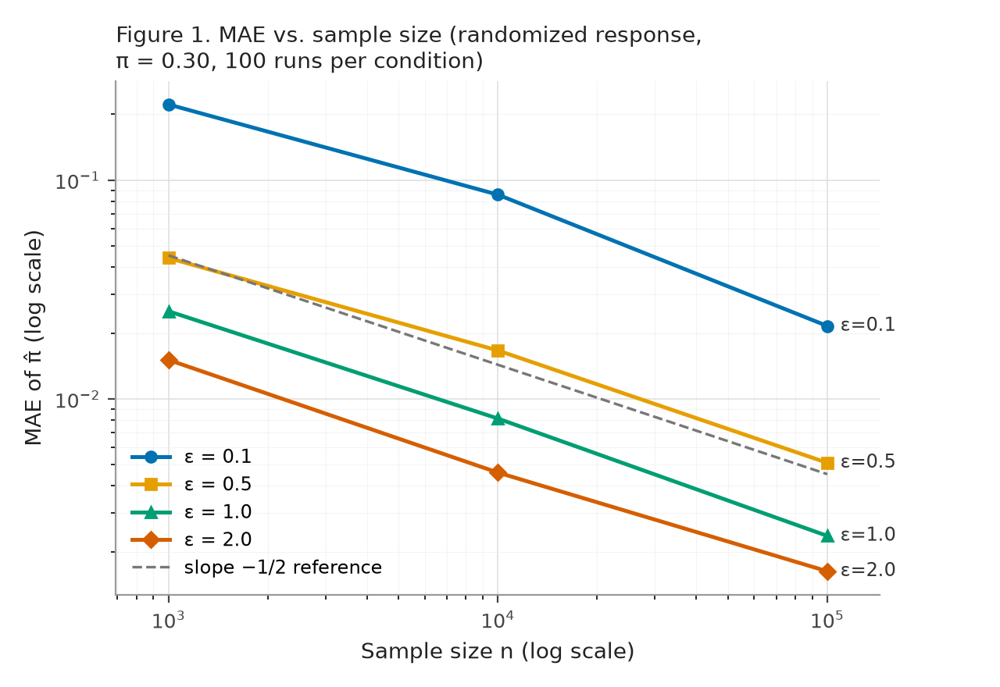
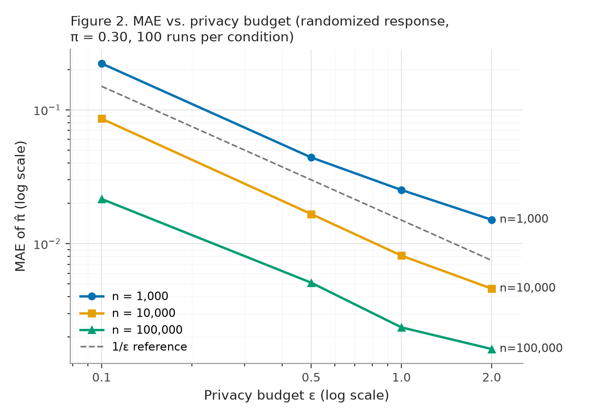

# Utility–Privacy Trade-off under Local Differential Privacy

A Monte Carlo study of how estimation error scales with the privacy budget (ε) and
sample size (n) under **local differential privacy (LDP)** — the validation experiment
for my undergraduate research report, *Design of a User-Behavior Data Collection and
Analysis System Applying Differential Privacy* (Hanyang University, 2026).

The report proposes a client-side LDP collection architecture with a centrally managed
privacy budget, and predicts how accuracy should behave as ε and n vary. This repository
runs that experiment end to end and checks every prediction against theory.

## What it does

- Simulates **randomized response** (forced-response variant: answer truthfully with
  probability p = (e^ε − 1)/(e^ε + 1), otherwise flip a fair coin) for estimating a
  population proportion π = 0.30 over a synthetic population of 1,000,000 users.
- Sweeps ε ∈ {0.1, 0.5, 1.0, 2.0} × n ∈ {1,000; 10,000; 100,000}, **100 runs per
  condition** with a fixed seed, and reports MAE, error percentiles, 95% CI width,
  and CI coverage.
- Runs a supplementary **Laplace mechanism** experiment (bounded mean on [0, 1]) to
  check the standard-error approximation SE ≈ (b−a)/(ε√n).

## Key results

| Prediction | Result |
|---|---|
| Error decreases monotonically in ε | ✅ Confirmed across all n; tracks 1/ε in the small-ε regime where p ≈ ε/2 |
| Error decreases at the √n rate | ✅ Log-log slopes of MAE vs. n: −0.51, −0.47, −0.51, −0.48 (theory: −1/2) |
| Large n makes small budgets usable | ✅ With a caveat: at n = 100,000, even ε = 0.1 reaches ~2-point typical error, but its 95% CI half-width is still ±6.2 points |
| 95% CI coverage | 0.95–0.99 across all 12 conditions |
| Laplace SE ≈ (b−a)/(ε√n) | Correct in form, but understates the constant by √2 — measured SD matches (b−a)·√2/(ε√n) |

The weakest corner is quantified honestly: at ε = 0.1 with n = 1,000 the mechanism is
effectively unusable — the average CI is wider than the entire [0, 1] range and 14% of
raw estimates fall outside [0, 1] (estimates are reported unclipped to keep the
estimator unbiased).

| | |
|---|---|
|  |  |

## Reproduce

```bash
pip install -r requirements.txt
python dp_simulation.py
```

Single script, fixed seed (20260604), no post-hoc selection of runs. Outputs land in
`results/` (CSV aggregates + both figures) and the full write-up is in
[`docs/experimental_results.md`](docs/experimental_results.md), including a proposed
erratum for the ε–p relation printed in the report's Section 4.1 (the published
relation ε = ln(p/(1−p)) belongs to the direct-perturbation variant; the mechanism
actually used implies ε = ln((1+p)/(1−p))).

## Repository layout

```
dp_simulation.py              the whole experiment (NumPy / pandas / Matplotlib)
results/                      condition-level aggregates + figures
docs/experimental_results.md  report-ready results section + erratum note
```

## Author

Won Gyu Lee — Dept. of Information Systems, Hanyang University
